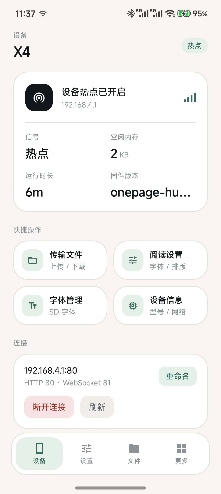
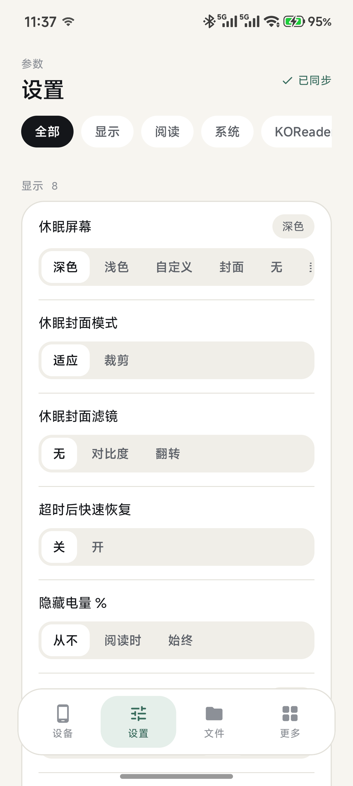
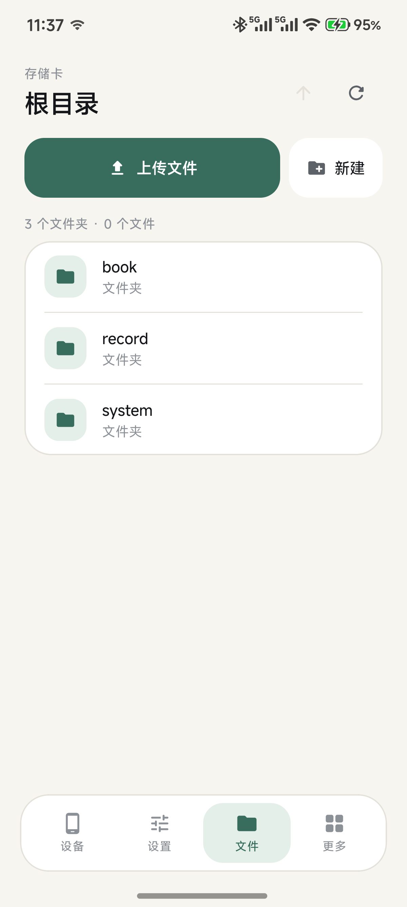
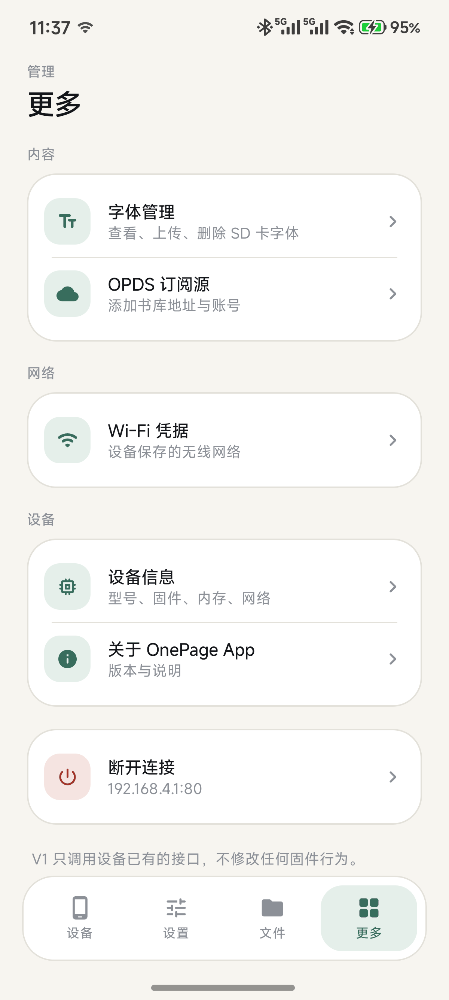

# OnePage App

Android 手机端伴侣应用：连接 OnePage 阅读器，改设置、管文件、装字体。

- **单平台**：Android 8.0+（minSdk 26），Kotlin + Jetpack Compose，Material 3
- **零固件改动**：只调用设备已有的 HTTP / WebSocket 接口（与设备自带网页版同一套）
- **连接方式**：局域网（同路由器）/ 设备热点（`CrossPoint-Reader`，默认 `192.168.4.1`）/ UDP 自动发现（端口 8134）

## 截图

<p align="center">
  
  
  
  
</p>

<p align="center">
  <sub>设备 · 设置 · 文件 · 更多　|　真机截图：小米 24129PN74C 连接 OnePage X4 热点</sub>
</p>

## 功能（v1）

| 模块 | 能力 |
|---|---|
| 连接 | **扫码连接**（Wi-Fi 码自动加入热点 / 网址码直接连）、UDP 广播自动发现、手动输入 IP、保存多台设备、重命名、断开；未连设备也能看「关于与更新」 |
| 设备 | 版本 / 型号 / IP / 模式 / 信号 / 空闲内存 / 运行时长，每 6 秒刷新 |
| 设置 | 设备返回的 schema 驱动，共 4 大类 50 项：开关、枚举、滑杆、文本；改动即写回，失败回滚 |
| 文件 | 浏览、上传（WebSocket 分片 + 进度）、下载、新建目录、重命名、移动、删除 |
| 字体 | 字体家族列表（字号 / 文件数 / 体积）、上传 `.cpfont`、删除家族 |
| OPDS | 订阅源增删 |
| Wi-Fi | 设备保存的 SSID 增删（密码只写不读） |
| 更新 | **进应用即检查**新版本（Gitee 镜像优先、GitHub 兜底），**App 内下载**并校验 SHA-256，交给系统安装器；也可在浏览器打开 Release |
| 固件 | 仅 `onepage-hub-*` 固件：设备信息页 / 更多 → 设备里的「固件更新」，从同一套镜像拉 `firmware.bin`，推送到设备 `/api/ota`，显示下载 / 上传 / 写入进度，设备自行重启 |

不做：BLE 直连（固件无 GATT 服务）、手机端刷机、阅读进度同步。

## 构建

```bash
# 需要 JDK 17 + Android SDK 34
./gradlew assembleDebug      # 调试包
./gradlew assembleRelease    # 正式包（需先配置签名，见下）
./gradlew testDebugUnitTest  # 单元测试（77 个用例，无需设备）
./gradlew updateDebugScreenshotTest   # 生成 Preview 截图，逐屏视觉验收
```

产物在 `app/build/outputs/apk/release/` 与 `app/build/outputs/apk/debug/`。

`local.properties` 指向本机 Android SDK。发布签名用的 `keystore.properties`
（`storeFile` / `storePassword` / `keyAlias` / `keyPassword`）与 `onepage-release.jks` 就放在本工程根目录，
两者都在 `.gitignore` 中、不会进版本库；**这两个文件是 1.0.0 起沿用至今的同一把 key，丢了就没法覆盖升级**。
缺省时 `assembleRelease` 产出的是未签名包。

## 测试

- `ParsersTest`（JVM，13 例）：用固件真实 JSON 形状验证 status / settings（四种类型）/ files / fonts / opds / wifi / UDP 发现应答的解析，含缺字段、布尔值、字符串数字、脏数据等边界。
- `DeviceApiTest`（JVM + MockWebServer，14 例）：验证发出去的真实 HTTP 请求——路径、query 编码、表单字段名、JSON body、Content-Type、multipart 字段、OTA 上传与状态、错误码映射（含设备纯文本 / JSON 两种错误格式）。
- `QrPayloadParserTest`（JVM，8 例）：扫码连接的三种载荷（Wi-Fi 码 / 网址码 / 裸 IP）与脏码拒绝。
- `ReleaseParserTest`（JVM，12 例）：GitHub / Gitee 两种「最新 Release」响应的解析、APK 资产挑选与 `digest` 归一化、tag 装饰（`v` / `release-` / `-beta`）与版本比较、日期与说明截断。
- `UpdateApiTest`（JVM + MockWebServer，8 例）：镜像优先级（Gitee → GitHub）、单个镜像失败时的兜底、全部失败时的合并报错、限流识别、APK 下载落盘与 SHA-256 校验（不符/截断即删文件）。
- `WifiJoinTest`（JVM，6 例）：加入热点失败的五种原因对应的中文提示——每条都要点名 SSID 并指向手动入口（开放网络没有一次性成功时，用户唯一能走通的路）。
- `FirmwareParserTest`（JVM，10 例）：`onepage-hub` 前缀识别、Release 里 `firmware.bin` 的挑选（排除 0x0 整包）、tag 与设备版本号比较、`/api/ota/status` 解析（含重启后的 `lastResult`）。
- `FirmwareApiTest`（JVM + MockWebServer，6 例）：固件镜像优先级与回退、下载落盘与进度、连接中断 / 长度不符时删文件并报错。
- `updateDebugScreenshotTest`：11 张 Preview 截图（含深色模式），作为 UI 回归基线。

## 检查更新

App 自己的更新走 Release 页面，不走应用商店：

| 项 | 值 |
|---|---|
| 首选源 | Gitee 镜像 `https://gitee.com/Yann_Fang/onepage-app` → `GET /api/v5/repos/Yann_Fang/onepage-app/releases/latest` |
| 兜底源 | GitHub `https://github.com/YannFang2002/onepage-app` → `GET /api.github.com/repos/YannFang2002/onepage-app/releases/latest` |
| 时机 | **每次进应用**静默查一次（有新版就弹窗）+「更多 → 软件更新」手动重查 |
| 比较 | `tag_name` 去掉 `v` / `release-` / `-beta` 装饰后，按数字段与 `BuildConfig.VERSION_NAME` 逐段比较；不解析 body、不依赖 `versionCode` |
| 下载 | 取 Release 里第一个 `.apk` 资产，**App 内下载**（进度、可重试），按 Release 的 `digest` 校验 SHA-256 后交给系统安装器；也可跳浏览器手动下载 |
| 安装 | 通过 `FileProvider` 交给系统安装器，首次需要允许 OnePage「安装未知应用」；不在后台静默安装 |
| 认证 | 不携带 token（公开仓库无需），限流时提示「接口限流，请稍后再试」 |

两个源都不携带密钥；安装包的真伪由 SHA-256（源提供时）与 Android 自身的签名校验共同保证（覆盖升级必须同签名）。

发布新版本时：`versionCode` +1、`versionName` 改成 `x.y.z`、打 tag `vx.y.z`、Release 附件命名
`OnePage-x.y.z.apk`。Gitee 仓库是**手动同步**的镜像，改动源地址只需改
`core/update/UpdateSource.kt` 一处。发布说明草稿（含包大小 / SHA-256 / 证书指纹）放在
`docs/releases/`，可直接贴到两个镜像的 Release 里。

## 扫码连接

设备「文件传输」页在 AP 模式下会画两个二维码（`CrossPointWebServerActivity::renderServerRunning`）：

| 码 | 内容 | App 行为 |
|---|---|---|
| Wi-Fi 码 | `WIFI:S:CrossPoint-Reader;;`（固件为开放网络，省略 `T:`/`P:`） | 系统弹窗确认后加入热点，取网关地址（回落 `192.168.4.1`）并连接 |
| 网址码 | `http://192.168.4.1/`（C61 无 mDNS，直接编 IP） | 直接连该地址 |

解码走 **ZXing + CameraX 本地识别**（不用 ML Kit，避免依赖 Google Play 服务，国产机型也能用）；图像不出本机。
Android 10+ 用 `WifiNetworkSpecifier` 加入热点——系统会弹一次「连接到此网络」确认，这是第三方 App 唯一的合规路径，无法完全静默。

## 无硬件开发

```bash
node tools/mock-device/server.mjs --port 8080
```

模拟器里手动连接 `10.0.2.2:8080`；局域网内手机连 `http://<电脑IP>:8080`。
mock 服务复刻了固件的全部 JSON 形状（含 25 个设置项、文件树、字体表、OPDS、Wi-Fi）。

## 设备端接口（对照 `CrossPointWebServer.cpp`）

| 用途 | 请求 |
|---|---|
| 状态 | `GET /api/status` |
| 读设置 | `GET /api/settings` → `[{key,name,category,type,value,options,min,max,step}]` |
| 写设置 | `POST /api/settings` `{key: value}`（局部更新，设备落盘） |
| 列目录 | `GET /api/files?path=/` |
| 上传（大） | WS `:81` `START:<name>:<size>:<path>` → `READY` → 二进制帧 → `PROGRESS:x:y` → `DONE` |
| 上传（小） | `POST /upload?path=/`（multipart，字段 `file`） |
| 下载 | `GET /download?path=...`（无 Range，不支持续传） |
| 目录操作 | `POST /mkdir {name,path}`、`/rename {path,name}`、`/move {path,dest}`、`/delete {path}` |
| 字体 | `GET /api/fonts`、`POST /api/fonts/upload`（`family`+`file`）、`POST /api/fonts/delete` `{family}` |
| OPDS | `GET/POST /api/opds`、`POST /api/opds/delete` `{index}` |
| Wi-Fi | `GET/POST /api/wifi`、`POST /api/wifi/delete` `{index}` |
| 发现 | UDP `8134` 发 `hello` → `crosspoint (on <host>);<wsPort>` |

## 结构

```
app/src/main/java/com/onepage/companion/
├─ core/model/     数据模型（status / settings / files / fonts / opds / wifi）
├─ core/net/       DeviceApi（OkHttp）、WsUploader（上传状态机）、Discovery（UDP）
├─ core/update/    更新源（Gitee / GitHub）、Release 解析、版本比较、UpdateApi
├─ core/firmware/  固件 OTA：onepage-hub 识别、firmware.bin 下载、/api/ota 推送
├─ core/data/      DeviceStore（已保存设备）
├─ ui/theme/       调色板、字体阶梯、形状
├─ ui/components/  卡片、按钮、输入框、弹层、进度条
├─ ui/screens/     connect / home / settings / files / more(fonts|opds|wifi|info|update)
├─ ui/UpdateViewModel  更新检查状态机（启动即查）
└─ ui/MainShell    底部导航 + 页面切换
```

## 已知边界

- 设备接口无鉴权，同一网络内任何客户端都能改设置；App 不做假的“安全”提示。
- 设备退出网页服务会重启，连接会断，App 有 6 秒轮询与错误态提示。
- 下载不支持断点续传，大文件失败需重下。
- 设置项名称由设备按自身语言返回，App 直接展示。
- 更新只负责“发现 + 跳转下载”，不代装 APK；Gitee 镜像与 Release 需手动同步。
- 自动加入开放热点受系统限制（Android 10+ 只能走 `WifiNetworkSpecifier` 的系统弹窗）：失败时 App 给出手动入口，并在用户连上热点后自动继续连接设备。
- 固件 OTA 只对 `onepage-hub-*` 固件开放：其它固件没有 `/api/ota`，页面会明确说明。升级期间设备会重启，连接会中断一次。
- 只有 `onepage-app` 一个工程：原先并列的 `onepage-hub-app` 副本已合并进来，构建、签名、发布都在本仓库完成。
